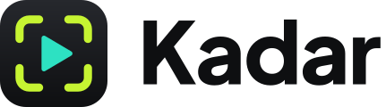
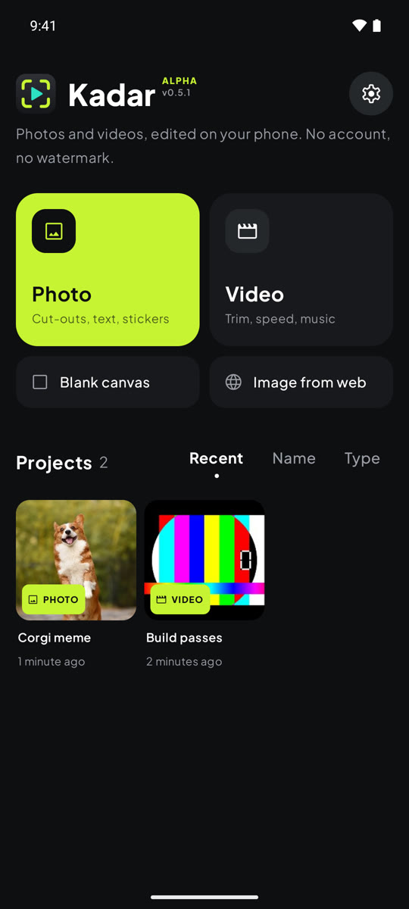
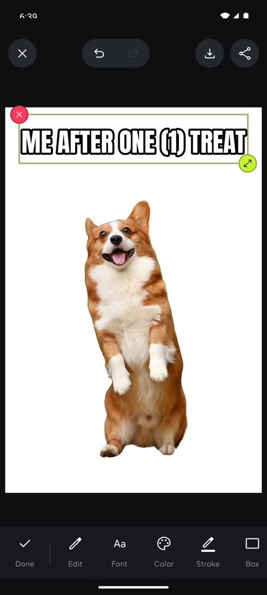
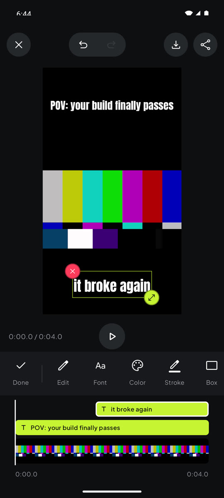
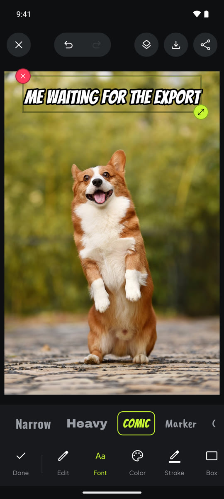
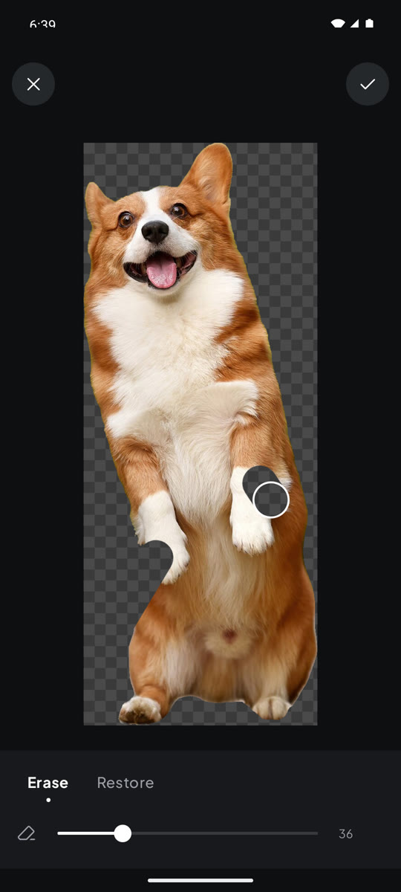

<p align="center">
  <picture>
    <source media="(prefers-color-scheme: dark)" srcset="docs/brand/kadar-logo-light-text.svg">
    
  </picture>
</p>

<p align="center">
  
  
  
</p>

<p align="center">
  <b>A free, open-source photo and video editor for Android.</b><br>
  Cut-outs, captions, stickers, trim, speed, music and a real layer timeline. No account, no subscription, no watermark, no ads.
</p>

<p align="center">
  <a href="https://github.com/n-delic/kadar/releases/latest"><b>Download the latest APK</b></a> ·
  <a href="#features">Features</a> ·
  <a href="#install">Install</a> ·
  <a href="#build-from-source">Build</a> ·
  <a href="CONTRIBUTING.md">Contribute</a>
</p>

---

*Kadar* (KAH-dar) is Bosnian for a frame or a shot in film. The app started because a meme page needed
the everyday editing tools, removing a background, slapping a caption on, speeding up a clip, adding
music, without paying a monthly fee for them. It grew into a general editor that runs entirely on the
phone.

## Features

### Photo

- **Layers.** Photos, images, text, emoji and stickers stack as layers. Drag to move, pinch to resize,
  twist to rotate, or use the corner handle to scale and rotate with one finger.
- **Background remover.** One tap cuts the subject out of any image, on the device. The cut-out stays
  exactly where it was on the canvas.
- **Eraser and restore brush.** Clean up the edges by hand; restore paints the original image back in
  place. Two fingers zoom and pan while you work.
- **Crop** any image layer, freely or at 1:1, 4:5, 9:16 or 16:9.
- **Adjust** brightness, contrast and saturation per image.
- **Text.** A classic meme font, eight more free caption fonts (tall, condensed, heavy, comic, marker,
  casual, retro script, horror) and the system fonts, fill and outline colors, a caption box behind the
  text, shadow, letter spacing and alignment. Double-tap text to edit it.
- **Snapping.** Layers snap to the center of the canvas and to 0° and 90°, with guide lines.
- **Canvas.** Original size or 1:1, 4:5, 9:16, 16:9, on white, black or a transparent background
  (exported as PNG).
- **My stickers.** Save any cut-out and reuse it in every project.

### Video

- **A timeline with layer tracks.** Every caption and sticker gets its own track above the clip. Drag
  its ends to choose when it appears and disappears, or drag the middle to move it.
- **Trim** the clip with handles on a strip of frames.
- **Speed** from 0.25x to 4x, with the voice pitch kept natural (or not, for the chipmunk effect).
- **Music.** Add a song, set its volume and where it starts; it loops or is cut to fit. The video's own
  sound has its own volume.
- **Canvas.** Turn a landscape clip into 9:16 for reels and stories, or 1:1 and 4:5 for feeds.
- **Adjust** brightness, contrast and saturation.
- **What you see is what you export.** The preview runs the same edit the exporter does.

### Everywhere

- **Projects save automatically** and reopen exactly as you left them.
- **Undo and redo** for every edit.
- **Images from the web.** A built-in browser: search, long-press an image, and it goes straight into
  the project. It never lands in your gallery.
- **Share to Kadar** from the gallery or any app to start a project.
- **Export** to `Pictures/Kadar` and `Movies/Kadar` (JPEG, PNG, H.264 MP4), or straight to the share sheet.

<p align="center">
  
  
</p>

## Privacy

Kadar has no accounts, analytics, ads or tracking, and it never uploads your photos or videos.

- Editing and export run entirely on the phone.
- The **only** feature that uses the internet is the image browser, and only while you use it.
- Background removal uses Google ML Kit on the device. The first time, Google Play services downloads
  the model (a few MB); after that it works offline. Your images are not sent anywhere.
- Projects live in the app's private storage. Uninstalling the app deletes them; your exports in the
  gallery stay.

## Install

1. Download `kadar-vX.Y.Z.apk` from the [latest release](https://github.com/n-delic/kadar/releases/latest).
   Each release also has a `.sha256` file if you want to check the download.
2. Open the APK on your phone. Android will ask you to allow installs from your browser or file
   manager; allow it for that app only.
3. Updates install over the old version and keep your projects, because every release is signed with
   the same key.

**Requirements:** Android 10 or newer. Background removal needs Google Play services (standard on
almost every phone sold outside China).

## Build from source

```bash
git clone https://github.com/n-delic/kadar.git
cd kadar
echo "sdk.dir=$HOME/Android/Sdk" > local.properties
./gradlew testDebugUnitTest assembleDebug     # tests + debug APK
./gradlew installDebug                        # install "Kadar Dev" on a connected phone or emulator
```

You need JDK 17 or newer and the Android SDK with platform 37. Debug builds install as a separate app,
**Kadar Dev**, so they never touch your real projects. Release signing and the full setup are in
[CONTRIBUTING.md](CONTRIBUTING.md).

## How it works

- **Kotlin and Jetpack Compose**, one module, no DI framework. The UI is custom-drawn on top of Compose.
- **One drawing path.** The editor, photo export, video overlay and thumbnails all draw layers with the
  same Android `Canvas` code, so exports match the screen.
- **Media3.** The video edit is a Media3 `Composition`: trim, speed, pitch, volume, music and canvas
  size are effects on it. `CompositionPlayer` previews it and `Transformer` exports it, with timed
  layers rendered as an overlay.
- **ML Kit Subject Segmentation** for cut-outs.
- **Projects** are a folder per project with a `project.json` (versioned, written atomically) and the
  images they use.

The code map and the rules for changing it are in [AGENTS.md](AGENTS.md); plans are in [ROADMAP.md](ROADMAP.md).

## Contributing

Bug reports, ideas and pull requests are welcome. Read [CONTRIBUTING.md](CONTRIBUTING.md) first.
In short: keep changes small, add a test for logic, try the change on a phone or emulator, and only add
assets under an open license, listed in [ATTRIBUTION.md](ATTRIBUTION.md).

## FAQ

**Is it really free?** Yes. No paid tier, no watermark, no ads. It's open source under the GPL.

**Why isn't it on Google Play?** Not yet. For now releases are published here as APKs.

**Can I use images from the web browser in my posts?** That depends on the image. Kadar only makes
downloading easier; you are responsible for having the right to use what you import.

**Does it work offline?** Everything except the image browser, and the one-time background-remover download.

## License and credits

Kadar is free software under the [GNU General Public License v3.0 or later](LICENSE), with an
additional permission for linking with Google Play services and ML Kit ([NOTICE](NOTICE)). You may use,
study, share and change it; if you distribute a modified version, you must publish its source under the
same license.

Kadar is an independent implementation written from scratch. It contains no code, decompiled code,
icons, images, fonts, stickers or presets from any other photo or video app; its workflow follows the
observable behavior of common mobile editors, and no other app's code or binaries were examined. Every
bundled asset is openly licensed and listed in [ATTRIBUTION.md](ATTRIBUTION.md). See [NOTICE](NOTICE).

Built with [AndroidX Media3](https://github.com/androidx/media),
[Jetpack Compose](https://developer.android.com/compose) and
[ML Kit](https://developers.google.com/ml-kit). Fonts: [Anton](https://github.com/googlefonts/AntonFont),
[Plus Jakarta Sans](https://github.com/tokotype/PlusJakartaSans) and Bebas Neue, Oswald, Archivo Black,
Bangers, Caveat Brush, Comic Neue, Pacifico and Creepster from [Google Fonts](https://github.com/google/fonts)
(all OFL). Icons:
[Material Symbols](https://github.com/google/material-design-icons) (Apache 2.0). The corgi in the
screenshots is a CC0 photo from Wikimedia Commons.

<sub>Android, Google Play and ML Kit are trademarks of Google LLC. All other product names are trademarks of their respective owners. Kadar is an independent open-source project and is not affiliated with, sponsored by or endorsed by Google or by the makers of any other photo or video editing app.</sub>
